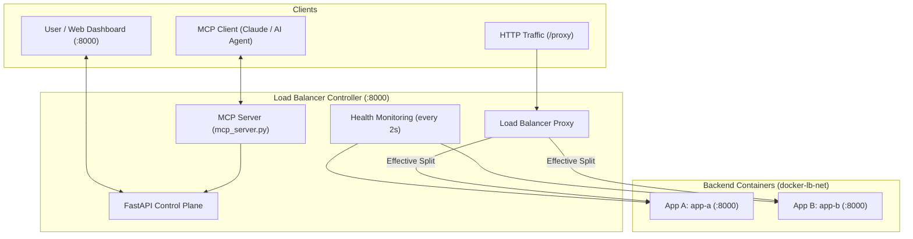

# DockRoute – Docker Load Balancer with MCP Controls

DockRoute is a zero-downtime HTTP load balancer routing traffic between containerized backends (Container A and Container B). It provides dual control planes: a real-time web dashboard and a Model Context Protocol (MCP) server for AI agent operations.

---

## 1. Key Features

- **Weighted Routing**: Smooth Weighted Round-Robin (SWRR) traffic distribution with smooth interleaving.
- **Dynamic Failover & Self-Healing**: Automatically routes 100% of traffic to a healthy survivor if one container fails, and restores configured splits upon recovery.
- **Zero-Downtime Safe Rollout**: 5-phase blue/green deployment with health verification, traffic switching, active request draining, and automatic rollback on failure.
- **Dual Control Planes**: Full operational control via an interactive Web Dashboard or AI assistants via the Model Context Protocol (MCP).
- **Audit Logging**: Persistent SQLite database recording all state changes and operator actions tagged by client origin (`dashboard`, `mcp`, `traffic-generator`, `api`).

---

## 2. Architecture



For full architectural details, see [docs/ARCHITECTURE.md](docs/ARCHITECTURE.md).

---

## 3. Technologies Used

- **Language & Runtime**: Python 3.12+
- **Control Plane & Proxy**: FastAPI, Starlette, Uvicorn, HTTPX
- **Database & Persistence**: SQLite3 (persistent volume-backed audit log)
- **AI Agent Protocol**: Model Context Protocol (MCP), FastMCP
- **Container Infrastructure**: Docker, Docker Compose, Docker SDK for Python
- **Frontend**: Vanilla HTML5, CSS3, JavaScript (Fetch API & Server-Sent Events)
- **Testing**: Pytest, AnyIO

---

## 4. Quick Setup & Run

### Prerequisites
- Docker & Docker Compose
- Python 3.12+ (for local testing/MCP server)

### 1. Start Cluster
```bash
docker compose up --build
```

### 2. Access Points
- **Web Dashboard**: [http://localhost:8000](http://localhost:8000)
- **Traffic Proxy**: `http://localhost:8000/proxy`
- **Cluster Status**: `http://localhost:8000/api/status`
- **Audit Logs API**: `http://localhost:8000/api/logs?limit=50`

### 3. Run MCP Server (AI Agent Bridge)
- **OpenCode**: Ready out of the box via `opencode.json`.
- **MCP Inspector (Interactive Web UI)**:
  ```bash
  npx @modelcontextprotocol/inspector python mcp_server.py
  ```
- **Claude Desktop / Cursor**: Configurable via stdio runner; see [docs/API_AND_MCP.md](docs/API_AND_MCP.md).

---

## 5. Important API Endpoints

| Method | Endpoint | Description |
| :--- | :--- | :--- |
| `GET` | `/proxy` | Proxies traffic to Container A or B according to the effective split. |
| `GET` | `/api/status` | Returns container states, health status, and active splits. |
| `GET` | `/api/logs` | Returns recent audit events from persistent SQLite database. |
| `POST` | `/api/split` | Sets traffic percentage split: `{"a": 70, "b": 30}` (must sum to 100). |
| `POST` | `/api/containers/{name}/stop` | Gracefully drains and stops a container (`a` or `b`). |
| `POST` | `/api/rollout/{target}` | Triggers zero-downtime rollout with health checks and draining. |

For the complete API and MCP tool reference, see [docs/API_AND_MCP.md](docs/API_AND_MCP.md).

---

## 6. How to Run Tests

Run the full pytest suite (23 unit and scenario tests):

```bash
python -m pytest tests/ -v
```

---

## 7. Demo Video

- **Demo Video**: [Watch the Walkthrough]([https://youtu.be/speka7QaMNY])

