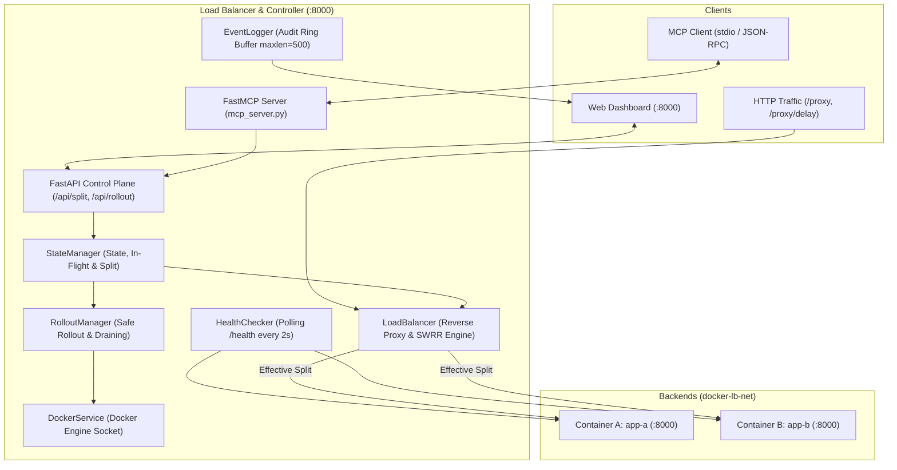
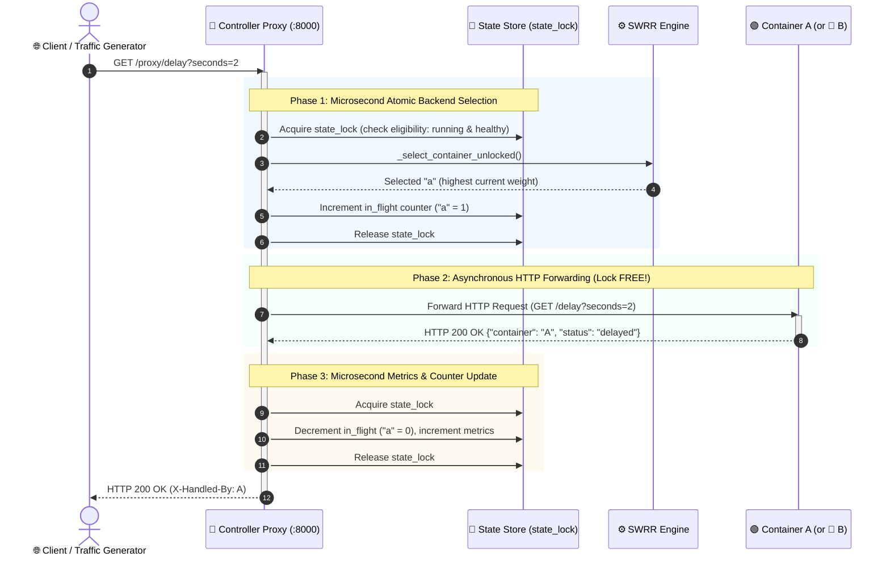
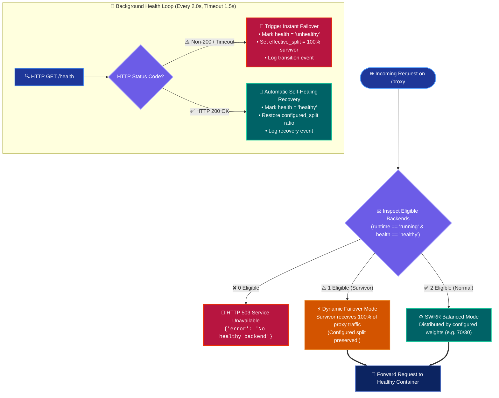

# DockRoute: Docker Load Balancer with Model Context Protocol (MCP) Controls


> **DockRoute** is a production-grade, health-aware Docker load balancer and autonomous container controller. It features deterministic **Smooth Weighted Round-Robin (SWRR)** traffic distribution, automated **health failover**, in-flight **request draining**, zero-downtime **safe rollouts**, an interactive real-time **web dashboard**, and full **Model Context Protocol (MCP)** integration for AI agent orchestration.

---

## 1. Project Overview

Modern cloud systems depend on resilient ingress proxies that can dynamically adapt traffic distribution, detect failed nodes, gracefully drain active connections before container shutdowns, and allow seamless blue/green deployments.

DockRoute implements these enterprise traffic-shaping patterns from first principles in a clean, observable Python 3 and Docker stack. It exposes both a real-time reactive web interface and a standardized **MCP stdio server**, enabling AI agents (such as Claude Desktop, Cursor, and Antigravity) to monitor and control load balancing, failovers, and deployments with full audit logging.

---

## 2. Problem Statement: Why Resilient Load Balancing Matters

1. **Traffic Clustering in Naive Balancers**: Simple weighted random balancers cause Poisson clustering over small batches (e.g., 10 consecutive requests hitting the same backend under a 70/30 split), creating canary instability.
2. **Abrupt Container Shutdowns**: Standard `docker stop` or pod eviction drops active TCP streams and truncates in-flight requests midway through processing.
3. **Configuration Erasure During Failovers**: Naive systems overwrite user-configured traffic weights when a backend goes down, requiring manual reconfiguration after node recovery.
4. **AI-Orchestrated Operations Without Safeguards**: Allowing LLMs to operate infrastructure without strict deterministic validation risks race conditions, concurrent rollout collisions, and accidental total cluster shutdowns.

---

## 3. Key Features

- **Smooth Weighted Round-Robin (SWRR)**: Guarantees mathematically exact, interleaved request distribution over any cycle without Poisson clustering.
- **Configured vs. Effective Split Separation**: Failovers route 100% of traffic to healthy survivors without silently overwriting the user's desired configuration; recovers automatically when healthy.
- **Active In-Flight Request Draining**: Tracks concurrent requests per container and waits for in-flight requests to complete before executing container termination.
- **Automated Safe Rollout & Rollback**: Orchestrates target startup, health probe verification, atomic traffic switching, old container draining, and Docker stop with automated rollback on health failure.
- **Two-Tier Locking Model**: Sub-millisecond `state_lock` for memory mutations isolated from `operation_lock` that serializes administrative workflows and rejects concurrent mutations with **HTTP 409 Conflict**.
- **Model Context Protocol (MCP) Bridge**: Exposes 8 standardized MCP tools delegating directly to the controller with `X-Source: mcp` provenance tracking.
- **Interactive Web Dashboard**: Built with vanilla CSS/HTML, providing real-time container metrics, live traffic split adjustment, companion value calculation, health toggles, and event logging.
- **Deterministic CLI Traffic Generator**: Layer 3 benchmark tool capable of sending paced traffic (1–120 RPM) with real-time ASCII telemetry.
- **100% Automated Test Coverage**: 23 comprehensive unit and multi-step scenario integration tests validated via pytest.

---

## 4. Architecture Overview

### High-Level System Architecture



For complete architectural details, see [docs/ARCHITECTURE.md](docs/ARCHITECTURE.md).

---

## 5. Request Lifecycle

1. A client request arrives at `http://localhost:8000/proxy` or `/proxy/delay`.
2. The proxy acquires `state_lock` and inspects eligible backends (`runtime == "running" && health == "healthy" && routing == "enabled"`).
3. If neither container is eligible, the proxy releases the lock and returns **HTTP 503 Service Unavailable**.
4. If backends are eligible, the **SWRR algorithm** selects the optimal container.
5. The container's `in_flight` counter is incremented, and `state_lock` is immediately released.
6. The request is forwarded over HTTP to the backend container (`app-a:8000` or `app-b:8000`).
7. Upon response return, `in_flight` is decremented and cluster metrics (`total`, `success`, `by_container`) are incremented under `state_lock`.
8. The response is returned to the client with `X-Handled-By: A` or `X-Handled-By: B`.



---

## 6. Load-Balancing Algorithm: Smooth Weighted Round-Robin (SWRR)

DockRoute replaces naive random routing with NGINX's **Smooth Weighted Round-Robin** algorithm.

### Algorithm Mechanics:
- Each candidate maintains a dynamic **current weight** $C_i$ (initial: 0) and a fixed **configured weight** $W_i$.
- For each request:
  1. Add $W_i$ to $C_i$ for all eligible containers.
  2. Select the container with the maximum $C_i$.
  3. Subtract total weight sum $S = \sum W_i$ from the selected container's $C_i$.

### 70/30 Split Sequence Walkthrough (10 Requests):
Under a 70% A / 30% B configuration ($S = 100$):

| Request # | Starting Weights $(C_A, C_B)$ | Added Weights | Selection | Decayed Weights |
| :---: | :---: | :---: | :---: | :---: |
| **1** | $(0, 0)$ | $(70, 30)$ | **A** $(70 > 30)$ | $(-30, 30)$ |
| **2** | $(-30, 30)$ | $(40, 60)$ | **B** $(60 > 40)$ | $(40, -40)$ |
| **3** | $(40, -40)$ | $(110, -10)$ | **A** $(110 > -10)$| $(10, -10)$ |
| **4** | $(10, -10)$ | $(80, 20)$ | **A** $(80 > 20)$ | $(-20, 20)$ |
| **5** | $(-20, 20)$ | $(50, 50)$ | **A** | $(-50, 50)$ |
| **6** | $(-50, 50)$ | $(20, 80)$ | **B** $(80 > 20)$ | $(20, -20)$ |
| **7** | $(20, -20)$ | $(90, 10)$ | **A** $(90 > 10)$ | $(-10, 10)$ |
| **8** | $(-10, 10)$ | $(60, 40)$ | **A** $(60 > 40)$ | $(-40, 40)$ |
| **9** | $(-40, 40)$ | $(30, 70)$ | **B** $(70 > 30)$ | $(30, -30)$ |
| **10**| $(30, -30)$ | $(100, 0)$ | **A** $(100 > 0)$ | $(0, 0)$ |

**Exact Result**: Sequence `A -> B -> A -> A -> A -> B -> A -> A -> B -> A` yielding exactly **7 A** and **3 B** with zero Poisson clustering.

For complete mathematical proofs and divergence handling, see [docs/LOAD_BALANCING.md](docs/LOAD_BALANCING.md).

---

## 7. Health Checks, Failover & Self-Healing

- **Dual-Layer Health Monitoring**: Checks Docker daemon container status (`running`) plus HTTP `GET /health` on backends every 2.0s with a 1.5s timeout.
- **Failover Logic**: When a backend fails, `effective_split` dynamically fails over 100% of traffic to the healthy survivor, leaving `configured_split` intact.
- **Self-Healing**: When the failed container recovers, `effective_split` automatically restores original configured weights without human intervention.
- **Full Outage Protection**: If both backends fail, `/proxy` returns HTTP 503 with structured JSON error details.



For complete failover documentation, see [docs/FAILOVER_AND_HEALTH_CHECKS.md](docs/FAILOVER_AND_HEALTH_CHECKS.md).

---

## 8. Request Draining & Safe Rollout

- **In-Flight Tracking**: Atomic counters track active processing per container.
- **Graceful Draining**: During container stops or rollouts, the target container is marked `draining` (receiving zero new requests) while active requests finish naturally up to a configurable timeout.
- **Zero-Downtime Safe Rollout (`POST /api/rollout/{target}`)**:
  1. Starts target container via Docker socket.
  2. Awaits verified HTTP 200 health check (aborts with HTTP 504 on timeout).
  3. Switches traffic atomically to target.
  4. Marks old container as `draining` and waits for in-flight requests.
  5. Stops old container via Docker Engine API.
  6. **Self-Healing Safeguard**: If the replacement container crashes while the old container is draining, the monitor cancels the rollout and immediately restores traffic to the old container.

For the detailed sequence and rollback triggers, see [docs/SAFE_ROLLOUT.md](docs/SAFE_ROLLOUT.md).

---

## 9. Model Context Protocol (MCP) Architecture

DockRoute provides an **MCP stdio bridge** (`mcp_server.py`) using FastMCP:
- **Delegating Bridge Pattern**: The MCP server is stateless; it delegates all actions to the controller with header `X-Source: mcp`.
- **Audit Logging**: Every action triggered by an AI model is recorded in the controller's 500-event ring buffer.
- **Available Tools**:
  - `get_status` / `status`: Full cluster status and telemetry.
  - `set_traffic_split`: Modify desired percentages ($0 \le x \le 100$, sum=100).
  - `start_container`: Start container and await verified health.
  - `stop_container`: Drain in-flight requests and stop container.
  - `safe_rollout`: Zero-downtime rolling update with rollback protection.
  - `force_unhealthy`: Simulate failure or restore container health.
  - `get_recent_logs`: Query newest audit log entries.
  - `reset_metrics`: Reset request counters to zero.

For configuration files for Claude Desktop and Cursor, see [docs/MCP_INTEGRATION.md](docs/MCP_INTEGRATION.md).

---

## 10. Technology Stack & Design Decisions

| Component | Technology | Rationale |
| :--- | :--- | :--- |
| **Control Plane & Proxy** | Python 3.12 / FastAPI / Uvicorn | Async event-loop enables sub-millisecond memory-locked state checks and async reverse-proxy forwarding. |
| **HTTP Client** | HTTPX (AsyncClient) | High-performance asynchronous HTTP pooling with fine-grained timeout controls. |
| **Container Engine** | Docker & Docker Compose | Universal, reproducible local container virtualization with mounted Unix socket control. |
| **AI Integration** | Model Context Protocol (MCP) | Industry standard protocol connecting LLMs with tool execution environments. |
| **Testing** | pytest & pytest-asyncio | Standard Python async test runner with full fixture isolation. |
| **Frontend** | Vanilla HTML5 / ES6 / CSS | Zero external dependencies, fast loading, dark-mode design with responsive layout. |

For architectural trade-offs, see [docs/DESIGN_DECISIONS.md](docs/DESIGN_DECISIONS.md).

---

## 11. Prerequisites

- **Docker Desktop** (version 24.0+ recommended, Linux containers enabled).
- **Docker Compose** (v2 syntax).
- **Python 3.11, 3.12, or 3.13** (for local CLI tools, tests, and MCP server).

---

## 12. Installation & Quickstart

### Step 1: Clone the Repository
```bash
git clone https://github.com/your-username/docker-load-balancer-mcp.git
cd docker-load-balancer-mcp
```

### Step 2: Install Local Python Dependencies
```bash
# Windows PowerShell
python -m pip install -r requirements.txt pytest-asyncio

# Linux / macOS
python3 -m pip install -r requirements.txt pytest-asyncio
```

### Step 3: Launch the Stack with Docker Compose
```bash
docker compose up -d --build
```

Wait 10–15 seconds for images to build and health probes to verify. Verify running containers:
```bash
docker compose ps
```

---

## 13. Dashboard & Demonstration Walkthrough

Open **[http://localhost:8000](http://localhost:8000)** in your browser:

```
+-----------------------------------------------------------------------------------+
|  DockRoute / control plane                    [ Controller connected ]             |
+-----------------------------------------------------------------------------------+
|  Requests: 1,420    |  Success: 1,420    |  Failed: 0    |  Control: Idle         |
+-----------------------------------------------------------------------------------+
|  Container A (app-a) [ HEALTHY ]         |  Container B (app-b) [ HEALTHY ]       |
|  Routing: Enabled   | In-Flight: 0       |  Routing: Enabled   | In-Flight: 0     |
|  [Start A] [Drain + Stop A] [Unhealthy]  |  [Start B] [Drain + Stop B] [Unhealthy]|
+-----------------------------------------------------------------------------------+
|  Traffic Split:                                                                   |
|  [ Container A: 70% ]        [ Container B: 30% ]                                 |
|  [===========================Blue===================|========Green========]       |
|  Configured: A 70% · B 30%                          Effective: A 70% · B 30%      |
|  [Apply split] [Discard draft] [Safe rollout -> B] [Safe rollout -> A]            |
+-----------------------------------------------------------------------------------+
```

### Interactive Verification Scenarios:
1. **Adjust Traffic Split**: Change Container B to `35%` $\rightarrow$ Container A automatically calculates to `65%`. Click **Apply split** or press <kbd>Enter</kbd>.
2. **Observe Failover**: Click **Force unhealthy** on Container A. The dashboard immediately updates `Effective: A 0% · B 100%`, while `Configured:` remains 70/30.
3. **Simulate Recovery**: Click **Restore health** on Container A. Effective split seamlessly returns to 70/30.
4. **Trigger Safe Rollout**: Click **Safe rollout $\rightarrow$ B**. Watch the state machine transition through starting, health check, traffic shift, in-flight drain, and container stop.

---

## 14. CLI Traffic Generator

Generate synthetic traffic through the proxy to observe real-time distribution:

```powershell
# Send 60 requests per minute with live telemetry
python execution/traffic_generator.py --url http://localhost:8000 --rpm 60

# Send requests with artificial 2-second backend delays to observe in-flight draining
python execution/traffic_generator.py --url http://localhost:8000 --rpm 30 --delay 2
```

Live Output:
```text
[Traffic] Sent: 100   | OK: 100   | Fail: 0   | A: 70   | B: 30   | Ratio: 70% A / 30% B
```

---

## 15. REST API Reference (Summary)

| Method | Endpoint | Description |
| :--- | :--- | :--- |
| `GET` | `/api/status` | Complete system telemetry and container status. |
| `POST` | `/api/split` | Set desired traffic percentages (`{"a": int, "b": int}`). |
| `POST` | `/api/containers/{name}/start` | Start container `a` or `b` via Docker socket. |
| `POST` | `/api/containers/{name}/stop` | Drain in-flight requests and stop container. |
| `POST` | `/api/rollout/{target}` | Blue/green zero-downtime rolling update. |
| `POST` | `/api/containers/{name}/unhealthy` | Toggle synthetic container health failure. |
| `GET` | `/api/logs?limit=50` | Read event audit ring buffer. |
| `POST` | `/api/metrics/reset` | Reset traffic metric counters. |
| `ANY` | `/proxy` & `/proxy/{path}` | Forward traffic to selected backend via SWRR. |

For detailed payloads and error codes, see [docs/API_REFERENCE.md](docs/API_REFERENCE.md).

---

## 16. MCP Configuration & Usage

Configure your AI client by referencing `mcp_server.py`:

```json
{
  "mcpServers": {
    "dockroute": {
      "command": "python",
      "args": ["C:\\path\\to\\docker-load-balancer-mcp\\mcp_server.py"],
      "env": {
        "CONTROLLER_URL": "http://localhost:8000"
      }
    }
  }
}
```

Now ask your AI agent:
> *"Inspect the load balancer status, set a 60/40 traffic split, and execute a safe rollout to Container B."*

---

## 17. Automated Testing Suite

DockRoute includes 23 automated unit and scenario integration tests:

```powershell
python -m pytest tests/ -v
```

Execution Summary:
```text
tests/test_logic.py::test_valid_splits PASSED                            [  4%]
tests/test_logic.py::test_invalid_splits[101--1] PASSED                  [  8%]
tests/test_logic.py::test_invalid_splits[-1-101] PASSED                  [ 13%]
tests/test_logic.py::test_invalid_splits[60-30] PASSED                   [ 17%]
tests/test_logic.py::test_invalid_splits[50-51] PASSED                   [ 21%]
tests/test_logic.py::test_invalid_splits[110-0] PASSED                   [ 26%]
tests/test_logic.py::test_effective_split_uses_desired_ratio_when_both_healthy PASSED [ 30%]
tests/test_logic.py::test_single_healthy_container_gets_all_effective_traffic_even_if_weight_zero PASSED [ 34%]
tests/test_logic.py::test_draining_container_is_not_eligible PASSED      [ 39%]
tests/test_logic.py::test_no_healthy_backend_returns_zero_effective_split PASSED [ 43%]
tests/test_scenarios.py::test_normal_routing_selection PASSED            [ 47%]
tests/test_scenarios.py::test_split_70_30_small_and_large_samples PASSED [ 52%]
tests/test_scenarios.py::test_split_100_0_never_selects_b PASSED         [ 56%]
tests/test_scenarios.py::test_invalid_splits_rejected PASSED             [ 60%]
tests/test_scenarios.py::test_one_container_unhealthy_failover_and_logging PASSED [ 65%]
tests/test_scenarios.py::test_both_containers_unhealthy_returns_503 PASSED [ 69%]
tests/test_scenarios.py::test_stopping_container_drains_in_flight_requests PASSED [ 73%]
tests/test_scenarios.py::test_stopping_last_healthy_container_rejected PASSED [ 78%]
tests/test_scenarios.py::test_safe_rollout_happy_path PASSED             [ 82%]
tests/test_scenarios.py::test_safe_rollout_target_timeout_recovery PASSED [ 86%]
tests/test_scenarios.py::test_mcp_tools_and_rejected_operations PASSED   [ 91%]
tests/test_scenarios.py::test_dashboard_metrics_and_events PASSED        [ 95%]
tests/test_scenarios.py::test_traffic_split_editing_and_preservation PASSED [100%]

============================= 23 passed in 2.20s ==============================
```

For detailed test coverage documentation, see [docs/TESTING.md](docs/TESTING.md).

---

## 18. Project Directory Structure

```text
docker-load-balancer-mcp/
├── .github/                       # GitHub workflows and issue templates
├── app/                           # Backend Application Container Image
│   ├── Dockerfile                 # Minimal Python 3.12-slim FastAPI image
│   └── main.py                    # Health, delay, and identifiable endpoints
├── controller/                    # Load Balancer & Control Plane Engine
│   ├── Dockerfile                 # Controller container image
│   └── main.py                    # SWRR proxy, health monitor, locking, REST API
├── docs/                          # Detailed Technical Architecture Docs
│   ├── API_REFERENCE.md           # Complete REST API specification
│   ├── ARCHITECTURE.md            # Component architecture & concurrency locks
│   ├── DESIGN_DECISIONS.md        # Engineering trade-offs & rationale
│   ├── FAILOVER_AND_HEALTH_CHECKS.md # Dual-tier health probes & failover
│   ├── LOAD_BALANCING.md          # Smooth Weighted Round-Robin mathematics
│   ├── MCP_INTEGRATION.md         # MCP tools reference & agent configuration
│   ├── SAFE_ROLLOUT.md            # In-flight request draining & rollouts
│   ├── SECURITY.md                # Docker socket threat model & hardening
│   └── TESTING.md                 # 23-test scenario matrix & results
├── execution/                     # Layer 3 Execution Tools (AGENTS.md)
│   └── traffic_generator.py       # Paced CLI traffic benchmark generator
├── static/                        # Web Dashboard Frontend
│   └── index.html                 # Single-page control plane UI (Vanilla JS/CSS)
├── tests/                         # Automated pytest test suites
│   ├── test_logic.py              # Mathematical unit tests
│   └── test_scenarios.py          # Cluster scenario integration tests
├── .dockerignore                  # Docker build exclusions
├── .gitignore                     # Git exclusions
├── controller-requirements.txt    # Controller Python dependencies
├── docker-compose.yml             # Orchestration configuration
├── LICENSE                        # MIT License
├── mcp_server.py                  # Model Context Protocol (MCP) Stdio Server
├── README.md                      # Comprehensive project documentation
└── requirements.txt               # Workspace dependencies (FastAPI, pytest, MCP)
```

---

## 19. Security Considerations & Known Limitations

- **Docker Socket Access**: The controller requires mounting `/var/run/docker.sock` to start and stop containers. This is acceptable for local development and demos, but should be replaced with a restricted Docker socket proxy in production.
- **Single Host Design**: Current implementation orchestrates containers on a single Docker host. Distributed production scaling would utilize Kubernetes or Docker Swarm.
- **Python Proxy Performance**: Built for deterministic observability, transparency, and education rather than gigabit-line-rate microsecond throughput.

For full threat modeling and hardening steps, see [docs/SECURITY.md](docs/SECURITY.md).

---

## 20. Future Improvements

- [ ] Dynamic addition of arbitrary backend containers (N-container pools beyond A and B).
- [ ] Integration with Prometheus/OpenTelemetry metrics scrapers.
- [ ] TLS termination support with automated Let's Encrypt certificates.
- [ ] Docker Socket Proxy sidecar integration for hardened privilege containment.

---

## 21. License & Author

- **License**: [MIT License](LICENSE)
- **Author**: Vidit
- **Portfolio Focus**: Systems Architecture, Cloud Infrastructure, Docker Orchestration, AI Tooling (MCP), and Cybersecurity.
