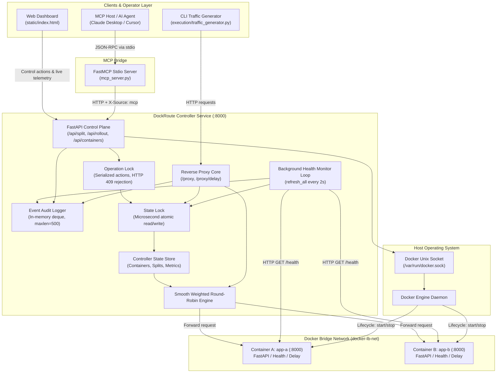

# DockRoute: System Architecture & Design

This document details the internal architecture, locking models, concurrency boundaries, and design considerations of **DockRoute** — a high-reliability, health-aware Docker load balancer with Model Context Protocol (MCP) controls.

---

## 1. Architectural Philosophy & Layering

DockRoute separates probabilistic, operator-facing intelligence (such as AI agents and human operators) from deterministic container orchestration and proxy routing.

```
+-------------------------------------------------------------------------------+
|                            OPERATOR INTERFACES                                |
|  Web Dashboard (HTML5/ES6)      MCP Client (Claude / AI)     CLI Traffic Gen  |
+-------------------------------------------------------------------------------+
                                        | HTTP (REST) / stdio
                                        v
+-------------------------------------------------------------------------------+
|                     DOCKROUTE CONTROLLER & PROXY ENGINE                       |
|                                                                               |
|  +------------------------+  +---------------------+  +--------------------+  |
|  |     Proxy Router       |  |   Control API       |  |  MCP Server Bridge |  |
|  |  /proxy, /proxy/delay  |  | /api/split, /rollout|  |  mcp_server.py     |  |
|  +------------------------+  +---------------------+  +--------------------+  |
|               |                         |                        |            |
|               v                         v                        v            |
|  +-------------------------------------------------------------------------+  |
|  |                        TWO-TIER LOCKING MODEL                           |  |
|  |  * state_lock: Protects atomic updates (weights, metrics, health status)|  |
|  |  * operation_lock: Serializes long operator workflows (rollout, drains) |  |
|  +-------------------------------------------------------------------------+  |
|               |                         |                                     |
|               v                         v                                     |
|  +------------------------+  +---------------------+                          |
|  | SWRR Selection Engine  |  | Event Audit Ring Log|                          |
|  | (Smooth Weighted RR)   |  | (500 capacity deque)|                          |
|  +------------------------+  +---------------------+                          |
+-------------------------------------------------------------------------------+
             |                                        |
             | Docker Engine API                      | HTTP Forwarding
             v                                        v
+--------------------------+              +-------------------------------------+
|      DOCKER DAEMON       |              |        BACKEND CONTAINERS           |
|   /var/run/docker.sock   |              |  App A (:8000)      App B (:8000)   |
+--------------------------+              +-------------------------------------+
```

---

## 2. High-Level Component Architecture (Mermaid)



---

## 3. Concurrency & Locking Mechanics

A recurring flaw in naive load-balancer implementations is holding state locks during network I/O or sleep intervals. DockRoute enforces strict isolation:

### Two-Tier Concurrency Architecture

1. **`state_lock` (`asyncio.Lock`)**:
   - **Scope**: Memory-only mutations (updating container health dictionaries, calculating SWRR weights, incrementing metrics counters, appending log entries).
   - **Duration**: Sub-millisecond execution.
   - **Critical Rule**: Network requests (forwarding traffic to containers, waiting for Docker daemon calls, polling health checks, or waiting for in-flight requests to drain) **NEVER** hold `state_lock`.

2. **`operation_lock` (`asyncio.Lock`)**:
   - **Scope**: Coarse-grained operator workflows (starting a container, stopping a container, executing a safe rollout, modifying splits).
   - **Non-blocking Rejection**: If an operation is already in progress, competing control requests receive an immediate **HTTP 409 Conflict** response. This prevents race conditions, conflicting target selections, or interleaved rollout steps.
   - **Audit Trail**: Every rejection is logged in the event ring buffer with source attribution (`dashboard`, `mcp`, `api`).

---

## 4. State Representation Model

The controller maintains a single authoritative state model:

```python
{
    "containers": {
        "a": {
            "name": "A",
            "container_name": "app-a",
            "runtime": "running",         # "running" | "stopped" | "stopping" | "unknown"
            "health": "healthy",          # "healthy" | "unhealthy" | "unknown"
            "routing": "enabled",         # "enabled" | "draining" | "disabled"
            "in_flight": 0,               # Active concurrent requests
            "last_health_check": "ISO",   # Timestamp
            "last_error": None,           # Last inspection or probe error
            "status": "healthy"           # Derived UI aggregate status
        },
        "b": { ... }
    },
    "configured_split": {"a": 70, "b": 30},
    "effective_split": {"a": 70, "b": 30},
    "metrics": {
        "total": 1420,
        "success": 1420,
        "failure": 0,
        "by_container": {"a": 994, "b": 426}
    },
    "rollout": None,                      # Active rollout telemetry if in progress
    "operation_busy": False               # Status of operation_lock
}
```

---

## 5. Event Audit Ring Buffer

DockRoute records an append-only in-memory log via Python's `collections.deque(maxlen=500)`:

- **Attributes**: `timestamp`, `action`, `source` (`dashboard`, `mcp`, `api`, `system`, `health-monitor`), `result` (`success`, `rejected`, `error`, `cancelled`, `failover`, `recovery`), and `details`.
- **Thread Safety**: Appending to a `deque` in Python is atomic; no await point can yield execution midway during log insertion.
- **Exposure**: Queryable via `GET /api/logs?limit=N` and MCP `get_recent_logs()`.

---

## 6. Failure Modes & Edge Case Safeguards

| Failure Mode | Naive Result | DockRoute Solution |
| :--- | :--- | :--- |
| **Both containers crash** | Proxy hangs or throws uncaught 500 | Detection in SWRR engine returns explicit **HTTP 503 Service Unavailable** with diagnostic payload. |
| **Stop last healthy container** | Cluster total outage | Validated in `stop_container()`. Rejects with **HTTP 409** and leaves container running. |
| **Rollout target fails health check** | Partial rollout / broken routing | Target timeout aborts rollout, logs `rollout_rollback`, keeps old container enabled, returns **HTTP 504**. |
| **Replacement container dies while old is draining** | Requests dropped / both down | Background monitor instantly restores old container to `enabled` and aborts stop workflow. |
| **Docker socket disconnect** | Controller crashes on inspect | Caught gracefully; marks container `unknown` with logged error while proxy attempts remaining healthy backends. |
