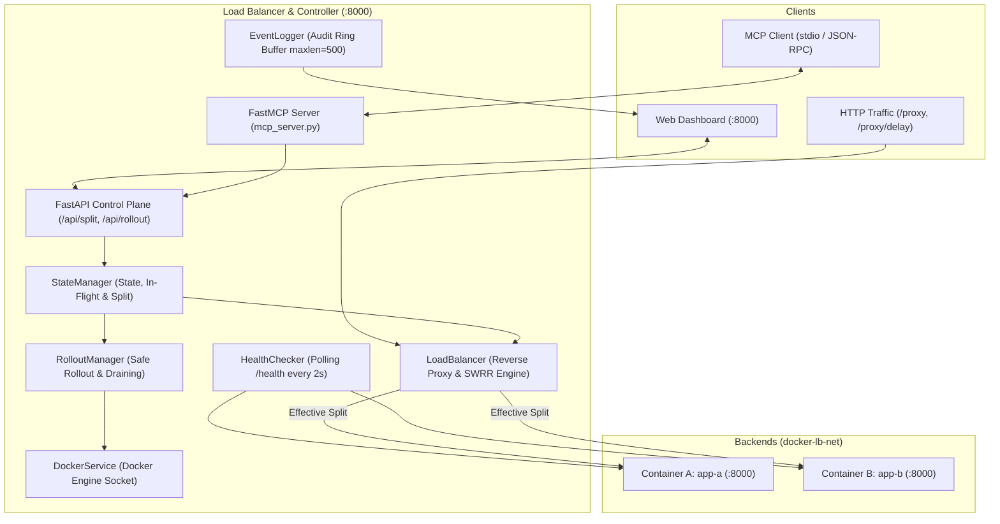

# DockRoute: System Architecture

DockRoute is a health-aware, zero-downtime HTTP load balancer designed for containerized microservices, featuring dual control planes: a real-time web dashboard and a Model Context Protocol (MCP) server for AI agents.

---

## 1. High-Level Component Architecture

---

## 2. Core Subsystems

1. **FastAPI Control Plane**: Exposes administrative endpoints for configuring splits, triggering rollouts, checking cluster status, and reviewing audit logs.
2. **Reverse Proxy Core**: Intercepts client traffic on `/proxy` and forwards requests to eligible backends using Smooth Weighted Round-Robin (SWRR).
3. **State & Concurrency Management**:
   - `state_lock`: Protects in-memory counters, health statuses, and metrics. Released immediately before network forwarding to ensure zero latency impact on proxying.
   - `operation_lock`: Serializes long-running workflows (rollouts, container stops) and rejects conflicting concurrent requests with `HTTP 409 Conflict`.
4. **Health Monitor Loop**: Asynchronously probes backend `/health` endpoints every 2 seconds. Automatically shifts 100% of traffic to healthy survivors if a backend fails, and restores configured ratios upon recovery.
5. **Connection Draining & Safe Rollout**:
   - Tracks active in-flight requests per container.
   - Marks target containers `draining` during rollouts or shutdowns, allowing in-flight requests to complete while routing new traffic away.
6. **FastMCP Server**: Provides standard Model Context Protocol tools over stdio, logging all agent-executed mutations with `source: mcp`.
