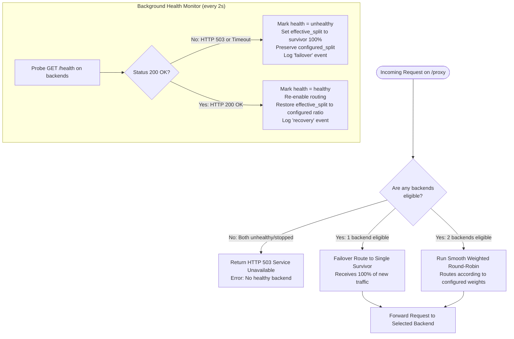

# DockRoute: Health Monitoring, Failover & Self-Healing

This document explains the active health monitoring, failover mechanics, and self-healing algorithms in **DockRoute**.

---

## 1. Multi-Tier Health Probe Model

DockRoute uses a dual-layer health verification model combining **Docker Engine daemon runtime status** with **HTTP application-layer probes**:

```
+------------------------------------------------------------------------------+
|                         HEALTH MONITORING PIPELINE                           |
|                                                                              |
|  1. DOCKER ENGINE INSPECTION                                                 |
|     * Queries Docker socket: /var/run/docker.sock                            |
|     * Checks container.status in ('running', 'created', 'exited', 'stopped') |
|     * Verifies physical container existence                                  |
|                                     |                                        |
|                     Is container 'running' in Docker?                        |
|                                    / \                                       |
|                              YES  /   \  NO                                  |
|                                  /     \                                     |
|                                 v       v                                    |
|  2. APPLICATION-LEVEL HTTP PROBE        Set runtime = 'stopped'              |
|     * Probes GET http://<container>:8000/health Set health = 'unknown'       |
|     * Strict timeout: 1.5 seconds       Cannot route traffic                 |
|     * 200 OK  -> Status: 'healthy'                                           |
|     * 503/Err -> Status: 'unhealthy'                                         |
+------------------------------------------------------------------------------+
```

---

## 2. Background Monitor Polling Loop

The health monitor runs continuously as an `asyncio.Task` started inside FastAPI's `lifespan`:
- **Default Interval**: 2.0 seconds (configurable via `HEALTH_INTERVAL_SECONDS`).
- **Parallel Probing**: Executes `asyncio.gather(*(refresh_one(n) for n in APP_NAMES))` to test all candidate backends concurrently.
- **Fail-Safe Exception Handling**: Probe network errors (connection reset, DNS resolution failure) do not crash the background task; they are recorded as `last_error` and logged to the event ring buffer.

---

## 3. Automatic Failover Logic

When a container transitions from healthy to unhealthy:
1. **Dynamic Eligibility Filtering**: `_eligible_unlocked(name)` evaluates:
   ```python
   c["runtime"] == "running" and c["health"] == "healthy" and c["routing"] == "enabled"
   ```
2. **Survivor Selection**:
   If only one container remains eligible:
   - The selection engine routes **100% of incoming requests** to the sole healthy backend.
   - It bypasses weights: even if the surviving backend was configured for 0% weight, it takes 100% to prevent service outage.
3. **Audit Event Generation**:
   The controller appends a transition log entry:
   `Container A transitioned to unhealthy. Effective split is now A=0%, B=100%.`
4. **Preservation of Desired Policy**:
   The operator's `configured_split` remains unchanged.

---

## 4. Self-Healing & Automatic Recovery

When an unhealthy or stopped container returns to full health:
1. The health probe receives `200 OK` from `/health`.
2. The controller automatically marks `health = "healthy"` and sets `routing = "enabled"`.
3. The selection engine recalculates `effective_split` using the intact `configured_split` weights.
4. Traffic smoothly resumes across both backends according to the original distribution.
5. An audit event is logged: `Container A recovered to healthy. Effective split is now A=70%, B=30%.`

---

## 5. Failover Flowchart (Mermaid)



---

## 6. Demonstrated Test Coverage

| Scenario | Tested In | Verification |
| :--- | :--- | :--- |
| **Failover to single healthy survivor** | `tests/test_scenarios.py:test_one_container_unhealthy_failover_and_logging` | Asserts survivor receives 100% of proxy traffic, effective split becomes 0/100, and transition event is logged. |
| **Both containers unhealthy** | `tests/test_scenarios.py:test_both_containers_unhealthy_returns_503` | Proves proxy immediately returns HTTP 503 with JSON detail when zero backends are eligible. |
| **Recovery after failure** | `tests/test_scenarios.py:test_traffic_split_editing_and_preservation` | Proves restoring container health immediately returns effective split to original configured weights. |
| **Single healthy container with 0% weight** | `tests/test_logic.py:test_single_healthy_container_gets_all_effective_traffic_even_if_weight_zero` | Proves failover override kicks in even if configured weight is 0. |
