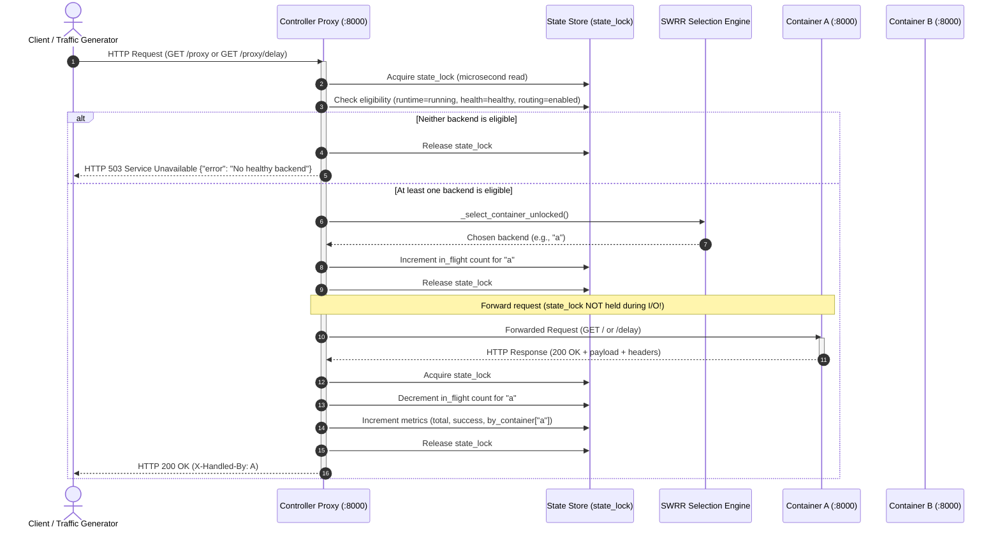

# DockRoute: Load Balancing & Traffic Routing Algorithm

This document details the traffic-routing mathematics, algorithm design, and state divergence handling implemented in **DockRoute**.

---

## 1. Why Random Routing Fails for Micro-Batches

Traditional naive load balancers often use random number generation (`random.random() < weight_a`) for weighted routing. While mathematically converging over millions of requests, weighted random distribution exhibits significant Poisson clustering and high variance over small request batches.

### Example: The 10-Request Clustering Problem
Under a 70% / 30% split with weighted random selection:
- The probability of 10 consecutive requests hitting Container A is:
  $$P(A^{10}) = 0.70^{10} \approx 2.82\%$$
- Almost 3 out of every 100 10-request bursts will route 100% of traffic to Container A and 0% to Container B, making canary deployments unpredictable and causing temporary resource starvation.

To satisfy strict enterprise-grade traffic shaping requirements, DockRoute implements **Smooth Weighted Round-Robin (SWRR)** (the algorithm popularized by NGINX).

---

## 2. Smooth Weighted Round-Robin (SWRR) Algorithm

SWRR guarantees:
1. **Zero Variance**: Over any full cycle of requests ($W_A + W_B$), the distribution matches the configured weights exactly.
2. **Optimal Interleaving**: Requests are evenly distributed across time without bursts or clusters of a single container.

### Algorithmic Definition

For each candidate container $i \in \{A, B\}$:
- Each candidate has a fixed **configured weight** $W_i$.
- Each candidate maintains a dynamic state variable: **current weight** $C_i$ (initialized to 0).
- The sum of all active weights is $S = \sum_{j} W_j$.

For each incoming request:
1. **Increase**: For every eligible candidate $i$, add its configured weight to its current weight:
   $$C_i \leftarrow C_i + W_i$$
2. **Select**: Pick the candidate $b$ with the greatest current weight:
   $$b = \arg\max_{i}(C_i)$$
3. **Decay**: Subtract the total weight sum $S$ from the selected candidate's current weight:
   $$C_b \leftarrow C_b - S$$
4. **Return**: Route the request to container $b$.

---

## 3. Step-by-Step Mathematical Walkthrough: 70/30 Split

Configured split: Container A = 70 ($W_A = 70$), Container B = 30 ($W_B = 30$). Total weight $S = 100$.

| Request | Initial Current Weights $(C_A, C_B)$ | Added Configured Weights | Updated $(C_A, C_B)$ | Selected Candidate (Max) | Subtracted Total ($C - 100$) | Final Current Weights |
| :---: | :---: | :---: | :---: | :---: | :---: | :---: |
| **1** | $(0, 0)$ | $(+70, +30)$ | $(70, 30)$ | **A** $(70 > 30)$ | $70 - 100 = -30$ | $(-30, 30)$ |
| **2** | $(-30, 30)$ | $(+70, +30)$ | $(40, 60)$ | **B** $(60 > 40)$ | $60 - 100 = -40$ | $(40, -40)$ |
| **3** | $(40, -40)$ | $(+70, +30)$ | $(110, -10)$ | **A** $(110 > -10)$| $110 - 100 = 10$ | $(10, -10)$ |
| **4** | $(10, -10)$ | $(+70, +30)$ | $(80, 20)$ | **A** $(80 > 20)$ | $80 - 100 = -20$ | $(-20, 20)$ |
| **5** | $(-20, 20)$ | $(+70, +30)$ | $(50, 50)$ | **A** (Tie break)*| $50 - 100 = -50$ | $(-50, 50)$ |
| **6** | $(-50, 50)$ | $(+70, +30)$ | $(20, 80)$ | **B** $(80 > 20)$ | $80 - 100 = -20$ | $(20, -20)$ |
| **7** | $(20, -20)$ | $(+70, +30)$ | $(90, 10)$ | **A** $(90 > 10)$ | $90 - 100 = -10$ | $(-10, 10)$ |
| **8** | $(-10, 10)$ | $(+70, +30)$ | $(60, 40)$ | **A** $(60 > 40)$ | $60 - 100 = -40$ | $(-40, 40)$ |
| **9** | $(-40, 40)$ | $(+70, +30)$ | $(30, 70)$ | **B** $(70 > 30)$ | $70 - 100 = -30$ | $(30, -30)$ |
| **10**| $(30, -30)$ | $(+70, +30)$ | $(100, 0)$ | **A** $(100 > 0)$ | $100 - 100 = 0$ | $(0, 0)$ |

### Outcome Analysis:
- Sequence of selection: **`A -> B -> A -> A -> A -> B -> A -> A -> B -> A`**
- Total selections in 10 requests: **7 A** (70%), **3 B** (30%).
- Current weights cleanly reset to $(0, 0)$ at the conclusion of request 10, ready for the next cycle.
- Notice the distribution: Container B is served at requests 2, 6, and 9. It is never starved, and Container A never takes more than 3 consecutive hits.

---

## 4. Configured Split vs. Effective Split

A central innovation in DockRoute is the architectural separation of **Configured Split** from **Effective Split**:

```
+-------------------------------------------------------------------------------+
| User Configuration (Desired State)                                            |
|   configured_split = {"a": 70, "b": 30}                                       |
+-------------------------------------------------------------------------------+
                                      |
                        Are both containers healthy?
                                     / \
                               YES  /   \  NO (e.g., Container A unhealthy)
                                   /     \
                                  v       v
+-----------------------------------+   +---------------------------------------+
| SWRR Routes by Desired Weights    |   | Health Failover Override              |
|   effective_split = {"a": 70, "b": 30} |   effective_split = {"a": 0, "b": 100}  |
+-----------------------------------+   +---------------------------------------+
                                          * Configured split remains 70/30 in state!
                                          * When A recovers, effective split auto-
                                            returns to 70/30 without human intervention!
```

### Definitions:
- **`configured_split`**: The operator's declared policy (e.g., 70% A / 30% B). This is preserved across reboots, health failures, and recoveries.
- **`effective_split`**: The active mathematical reality evaluated dynamically by `effective_split_unlocked()`:
  - If both containers are eligible $\rightarrow$ normalized active ratio (e.g., 70% / 30%).
  - If Container A is unhealthy $\rightarrow$ 0% A / 100% B.
  - If Container B is unhealthy $\rightarrow$ 100% A / 0% B.
  - If both containers are down $\rightarrow$ 0% A / 0% B (returns HTTP 503).

---

## 5. Request Lifecycle Sequence (Mermaid)


