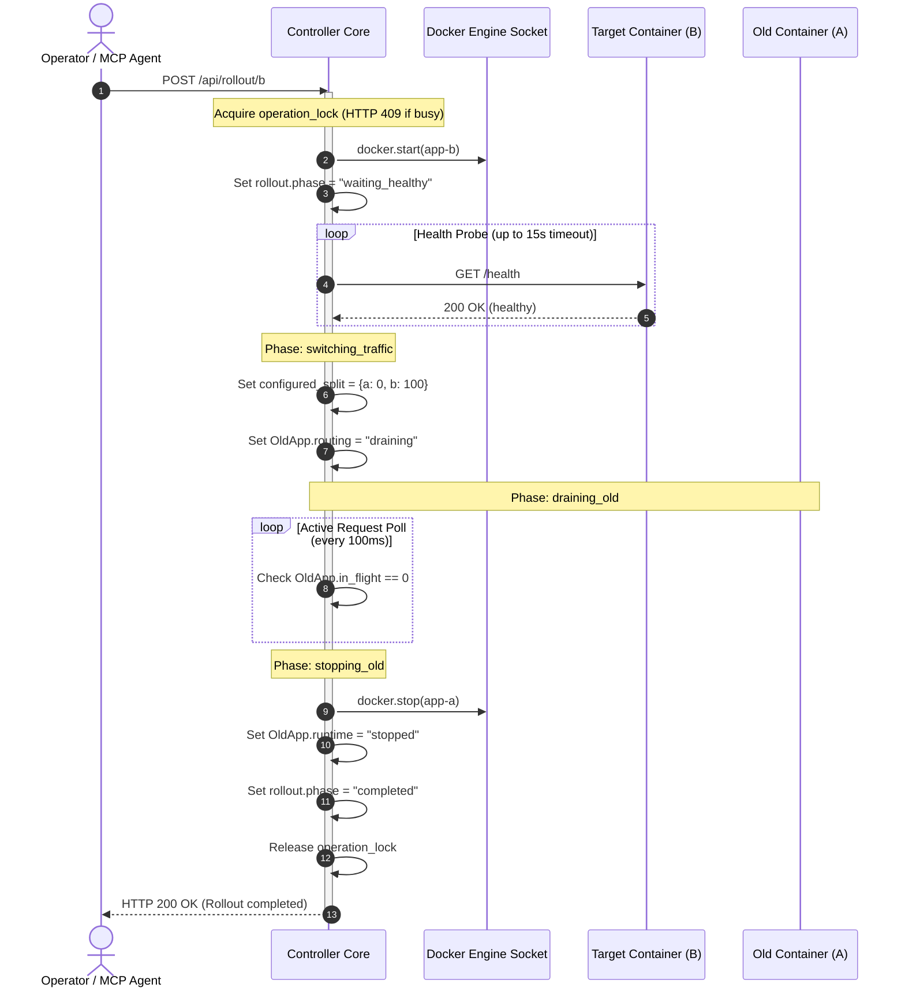

# DockRoute: Request Draining & Safe Rollout Protocol

This document explains the zero-downtime rolling deployment protocol, in-flight request draining mechanics, and automated rollback triggers in **DockRoute**.

---

## 1. The Core Problem: Why Naive Container Stops Cause Outages

In production microservices, suddenly issuing `docker stop` or deleting a pod drops active TCP connections and terminates in-flight operations (e.g., database writes, file uploads, payment transactions).

DockRoute implements an **active draining protocol**:
1. It immediately removes the target container from receiving **new requests**.
2. It waits for all **in-flight requests** currently being processed by the container to complete naturally.
3. Only after the active in-flight count reaches zero (or a strict safety timeout expires) is the container instructed to stop.

---

## 2. In-Flight Request Tracking Mechanism

In `controller/main.py`, tracking is managed through atomic counter increments and decrements inside `state_lock`:

```python
# 1. On incoming request dispatch:
async with self.state_lock:
    self.containers[selected]["in_flight"] += 1

try:
    # 2. Forwarding happens OUTSIDE state_lock
    response = await client.request(...)
finally:
    # 3. Always decremented in finally block
    async with self.state_lock:
        self.containers[selected]["in_flight"] -= 1
```

During a drain:
`_wait_drained(name, timeout)` polls the container's `in_flight` counter every 100 milliseconds. As soon as `in_flight == 0`, the drain resolves immediately without unnecessary waiting.

---

## 3. Safe Rollout Protocol (Blue/Green State Machine)

The `/api/rollout/{target}` workflow transitions through an explicit state machine:

```
[start_target] ---> [waiting_healthy] ---> [switching_traffic] ---> [draining_old] ---> [stopping_old] ---> [completed]
       |                    |                                             |
       v                    v                                             v
[abort / 502]        [timeout_abort / 504]                         [target_failed_recover]
                     * Traffic stays on old                        * Old container re-enabled!
                     * Rollout marked 'rolled_back'                * Rollout marked 'rolled_back'
```

### Protocol Steps:

1. **Lock Acquisition**: Acquires `operation_lock` to serialize deployments.
2. **Phase 1: `start_target`**: Calls Docker Engine API to start the replacement container.
3. **Phase 2: `waiting_healthy`**: Polls the target's `/health` endpoint until HTTP 200 is verified.
   - **Timeout Protection**: If the target does not become healthy within `health_timeout` (default: 15s), the rollout **aborts immediately**, leaves the existing container running at 100%, and returns HTTP 504.
4. **Phase 3: `switching_traffic`**: Switches `configured_split` to 100% target / 0% old. All subsequent incoming requests are routed to the new container.
5. **Phase 4: `draining_old`**: Marks the old container's routing state as `draining`. Waits for active `in_flight` requests to reach zero.
6. **Phase 5: `stopping_old`**: Issues `docker stop` to the old container via the Docker Engine API.
7. **Phase 6: `completed`**: Releases `operation_lock` and records full rollout metrics in the event log.

---

## 4. Safe Rollout Sequence (Mermaid)



---

## 5. Mid-Drain Self-Healing Rollback

An exceptional resilience feature implemented in DockRoute:
- If the replacement container **crashes or turns unhealthy while the old container is draining**, the background health monitor instantly detects the failure.
- It immediately cancels the stop workflow, re-enables routing on the old container (`routing = "enabled"`), returns `configured_split` to the old container, and marks the rollout as `rolled_back`.
- Zero dropped requests occur during unexpected target failure.
